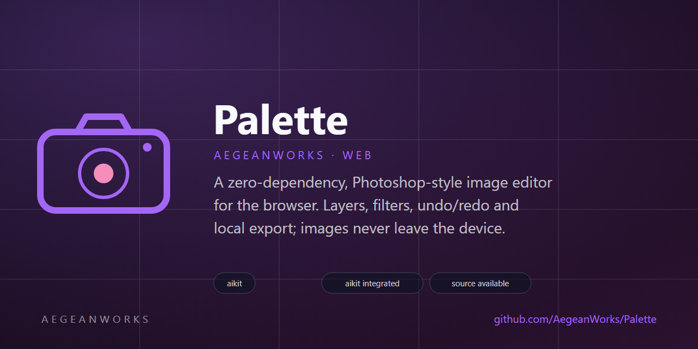
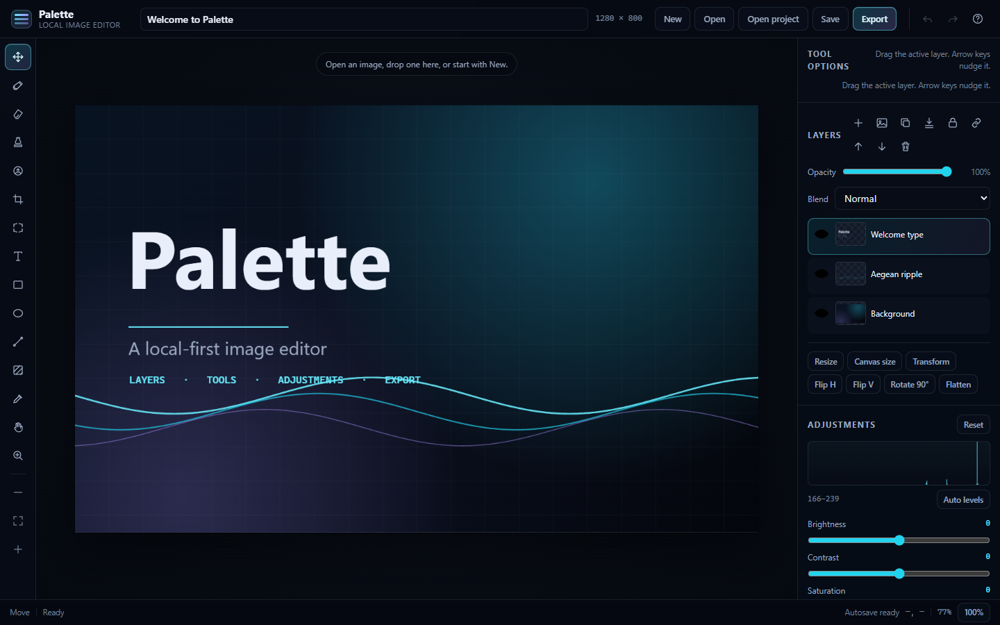
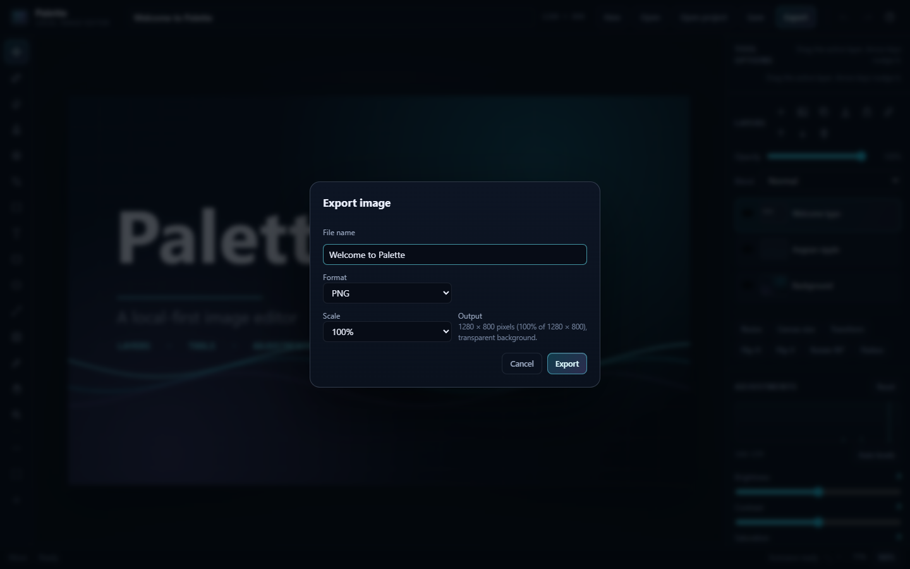

# Palette

<!-- aegean:media:start -->
<p align="center"></p>
<p align="center"><a href="LICENSE"></a> <a href="https://github.com/AegeanWorks/AIKit"></a></p>
<!-- aegean:media:end -->

A zero-dependency, Photoshop-style image editor for the browser. Layers, filters, undo/redo and local export; images never leave the device.

No server, no accounts, no uploads, no build step.

## ⚡ 30-Second Cold-Start Quick Reference

- **Runtime Prerequisites**: Node.js 20+ (tests and the local static server only) and any current Chromium, Firefox or Safari browser. The editor itself has no runtime dependencies.
- **Canonical Regression Shield Gate**:
  ```bash
  npm test
  ```
- **Run it locally**:
  ```bash
  npm start
  ```
  The server prints a local URL (default `http://127.0.0.1:4176/`) and `--open` opens the browser.

### 🛠️ AIKit Commands (run from the AIKit folder)
| Role | Command |
|---|---|
| Status, task and gates | `python aikit.py status palette` |
| Phase 4: every gate | `python aikit.py check palette` |
| Repair memory and map, then check | `python aikit.py fix palette` |
| Resume an interrupted task | `python aikit.py resume palette` |

## ✨ What It Does

- **Layers**: add, duplicate, delete, merge down, flatten, reorder, rename, hide, lock, clip to the layer below, change opacity, transform (scale/rotate/flip around visible content), place another image as a centered layer, and see live thumbnails.
- **Blend modes**: normal, multiply, screen, overlay, darken, lighten, color dodge/burn, hard/soft light, difference, exclusion, hue, saturation, color and luminosity, preserved in projects and exports.
- **Tools**: move, brush, eraser, clone stamp, dodge/burn, crop, marquee selection, text, rectangle, ellipse, line, linear/radial gradient, eyedropper, hand and zoom. Shift constrains squares, circles and 45° lines; Alt-click sets the clone source.
- **Selections**: rectangle or ellipse marquees clip paint, shapes, text, gradients and destructive filters, support selected-pixel moves, delete-selected, select-all, deselect, invert and crop-to-selection. Adjustments remain layer-wide.
- **Clipboard**: copy/cut the selection or the whole layer, paste as a new layer, and create layers via copy or cut with a single undo step. Pasted art is fitted and centred when the document size changed.
- **Adjustments**: non-destructive brightness, contrast, saturation, hue, grayscale, sepia, invert and blur stored per layer and visible in exports.
- **Filters**: blur, pixelate, sharpen, vignette, Levels (black point, white point and gamma) and Auto levels baked into the active layer or current selection with undo support.
- **Histogram**: a live luminance histogram of the active layer with a percentile-derived black/white range and a one-click Auto levels command that samples the active selection when one exists.
- **Document**: new document with white, transparent or custom background; open or drag-and-drop images; resize, canvas size with nine anchors, flip, rotate 90° and crop with free, 1:1, 4:3, 3:2, 16:9 or 9:16 ratios.
- **History**: bounded undo/redo for every edit, including blend-mode changes and merge-down, with a memory-conscious per-document limit.
- **Output**: export PNG, JPEG or WebP at 25–400% scale (quality control for lossy formats) and save/reopen a `.palette` project with embedded layer images.
- **Recovery**: debounced IndexedDB autosave of the full layer stack with a restore prompt after a reload, a live save status, and safe handling of quota or corrupt records. The welcome sample is never saved over a previous session.
- **Viewport**: wheel pan, Ctrl/Cmd + wheel zoom around the pointer, fit-to-view, actual size and a live cursor readout.

Everything happens in the browser. Images are never uploaded, and there is no network code in the editor.

## ⌨️ Keyboard Shortcuts

| Keys | Action |
|---|---|
| `V`, `B`, `E`, `S`, `C`, `M`, `T` | Move, brush, eraser, clone stamp, dodge/burn, crop, marquee, text |
| `R`, `O`, `L`, `G`, `I`, `H`, `Z` | Rectangle, ellipse, line, gradient, eyedropper, hand, zoom |
| `Ctrl/Cmd + A` / `Ctrl/Cmd + D` | Select all / deselect |
| `Shift + I` | Invert the selection |
| `Delete` / `Backspace` | Clear selected pixels |
| `Ctrl/Cmd + Z` | Undo |
| `Ctrl/Cmd + Shift + Z` or `Ctrl + Y` | Redo |
| `Ctrl/Cmd + S` | Save a `.palette` project |
| `Ctrl/Cmd + Alt + G` | Clip the active layer to the layer below |
| `Ctrl/Cmd + O` | Open an image |
| `Ctrl/Cmd + E` | Export |
| `[` / `]` | Decrease / increase brush or eraser size |
| `0` / `1` | Fit to view / 100% |
| `Space + drag` | Pan from any tool |
| Arrow keys | Nudge the active layer 1 px (`Shift` = 10 px) |
| `Enter` / `Escape` | Apply / cancel crop or text |

## 📦 What's Inside

```text
palette/
├── .gitignore
├── LICENSES/
├── README.md
├── index.html                 <- editor shell, dialogs, panels and tools
├── package.json               <- npm scripts, test command and version
├── src/
│   ├── theme.css              <- design tokens
│   ├── styles.css             <- responsive editor layout
│   ├── core/
│   │   ├── bounds.js          <- visible-content bounds for transforms
│   │   ├── color.js           <- hex/RGB helpers and clamping
│   │   ├── document.js        <- document and layer model
│   │   ├── export.js          <- format, quality and file-name rules
│   │   ├── filters.js         <- adjustments, sharpen, vignette, pixelate
│   │   ├── geometry.js        <- rects, viewport math and zoom
│   │   ├── gradient.js        <- gradient types, stops and drag thresholds
│   │   ├── histogram.js       <- tonal counts and percentile ranges
│   │   ├── history.js         <- bounded command history
│   │   └── project.js         <- .palette project validation and limits
│   └── ui/
│       ├── autosave.js        <- IndexedDB autosave, validation and restore
│       ├── canvas.js          <- canvas, image, blob and file bridges
│       ├── paint.js           <- brush, shape, text and transform rasterisers
│       ├── editor.js          <- state, tools, panels and file workflow
│       └── main.js            <- bootstrap (exposes window.palette for dogfood)
├── assets/
│   ├── favicon.svg
│   ├── logo.png
│   ├── logo.svg
│   ├── social-preview.png
│   ├── social-preview.svg
│   └── screenshots/
│       ├── 2026-10-31-home.png <- prior welcome capture (commit 0e484e5)
│       ├── 2026-11-02-home.png <- current welcome capture (commit 1bda086)
│       └── 2026-11-02-export.png <- export dialog (commit 1bda086)
├── scripts/
│   ├── serve.mjs              <- zero-dependency static server
│   └── dogfood.mjs            <- headless browser smoke pass
├── tests/                     <- Node test runner suites
├── .aikit/                    <- project memory: record, ledger, decisions and media
├── LICENSE                    <- Aegean License 1.1 (AL-1.1): free personal use
├── COMMERCIAL.md              <- Commercial licensing terms
└── REUSE.toml                 <- Machine-readable SPDX metadata
```

## 🧪 Verification

```bash
npm test          # core, server and static-contract suites
npm run dogfood   # real headless browser: autosave reload/restore, selections/invert, clipboard, layer via copy/cut, clipping masks, clone stamp, dodge/burn, crop ratios, flatten, canvas size, layer transform, histogram/auto levels, gradients, levels, locks, placement, brush, eraser, move, shapes, text, filters, resize, zoom, scaled export and project save
```

The dogfood pass starts the real static server, launches an installed Edge/Chrome, drives the UI through the DevTools protocol, and fails on a page error. It also verifies that PNG export and `.palette` project save download real files. It skips cleanly when no Chromium browser is available.

## 🔌 AegeanWorks Integration

Palette is vendored into the AegeanWorks site at `docs/editor/` and presented by `docs/editor.html`. The sync tool copies the runtime files and records their content hashes, so the published site is self-contained and hand edits break the site tests; `sync_editor.py --check` additionally catches drift from the Palette source.

```bash
# from the AegeanWorks project root
python tools/sync_editor.py
python tools/sync_editor.py --check
```

## 🧭 Design Notes

- **Static and local-first**: ES modules and Canvas 2D only; no bundler, no fonts, no CDNs.
- **CSP compatible**: scripts are external modules, styles are local, and no inline event handlers are used. Images are read through `File`/`Blob` URLs.
- **Testable core**: geometry, document state, history, project validation, colour and pixel filters are pure ES modules tested without a DOM.
- **Bounded state**: imported images and new documents are capped at 24 megapixels; history depth shrinks as documents grow.
- **Safe layers**: a lock flag blocks painting, moving, filters, adjustments, deletion and merge-down while still allowing visibility, naming, opacity, blend mode and reordering; projects preserve the flag.
- **Clipping masks**: a clipped layer is drawn only through the alpha of the nearest unclipped layer below; hiding that base hides the clipped stack, merging stays inside a clipping group, and `.palette` projects recall the flag.
- **Precise edits**: one immutable marquee shape is converted to a Canvas clip for paint, shapes, text, gradients and filters; selected-pixel moves redraw through the same clip so undo stays exact. Selection changes are session state and are cleared when the document dimensions change.
- **Clipboard**: patches are doc-sized canvases stored with their source dimensions; paste clones or contain-fits them, and layer-via-cut changes the source and adds the extracted layer in one history entry.
- **Autosave**: versioned IndexedDB records store layer PNG blobs plus metadata. Saves are debounced, serialized and skipped during gestures; the restore dialog validates the record first, and declining it clears the old copy.
- **Compositing**: layer opacity, adjustments and blend mode are applied by the Canvas 2D compositor in the viewport and in exported images; merge-down bakes the two layers' opacity and adjustments while keeping the lower layer's blend mode, and undo restores both layers.
- **Placement**: the Layers panel's image button decodes a local image, fits it inside the current document without upscaling, centers it above the active layer, and commits the placement as one undoable step.
- **Clone stamp**: Alt-click stores a source point, then each stroke samples a snapshot of the active layer through the brush mask and selection, so cloned pixels never feed back into the same stroke.
- **Dodge & burn**: one tool with a mode switch lightens or darkens only the layer's existing pixels through the brush mask and selection; transparent areas stay transparent and each stroke is one undo step.
- **Non-destructive adjustments**: the per-layer adjustment stack is a CSS filter at render/export time, so it can be reset without losing pixels.

## 📜 License

Free for personal use under the Aegean License 1.1 (AL-1.1); see [LICENSE](LICENSE). Any commercial use needs the Aegean Commercial License 1.0 (ACL-1.0); see [COMMERCIAL.md](COMMERCIAL.md).

<!-- aegean:brand-assets:start -->
## 🎨 Brand Assets

> **AI-Generated Brand Artwork.** The banner and logo are **AI-generated brand assets**. They are illustrative and may not literally depict every feature or the full project scope.
<!-- aegean:brand-assets:end -->

<!-- aegean:screenshots:start -->
## Screenshots

<a href="https://github.com/AegeanWorks/Palette/commit/1bda086"></a>

<a href="https://github.com/AegeanWorks/Palette/commit/1bda086"></a>

*commit `1bda086` · 2026-11-02 · viewport 1440x900 · prior `2026-10-31-home.png` (commit `0e484e5`) superseded after editor changes*
<!-- aegean:screenshots:end -->
